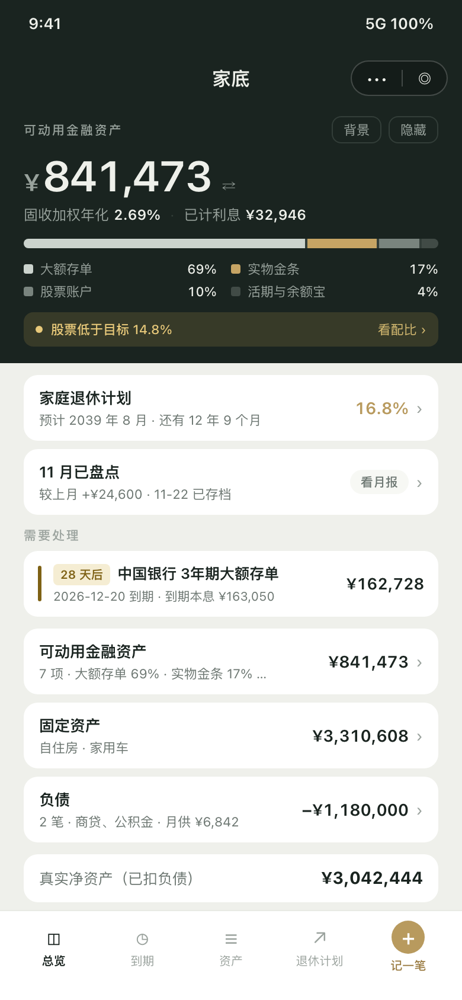
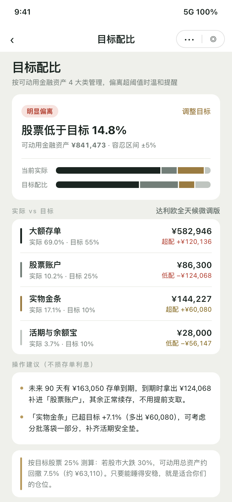
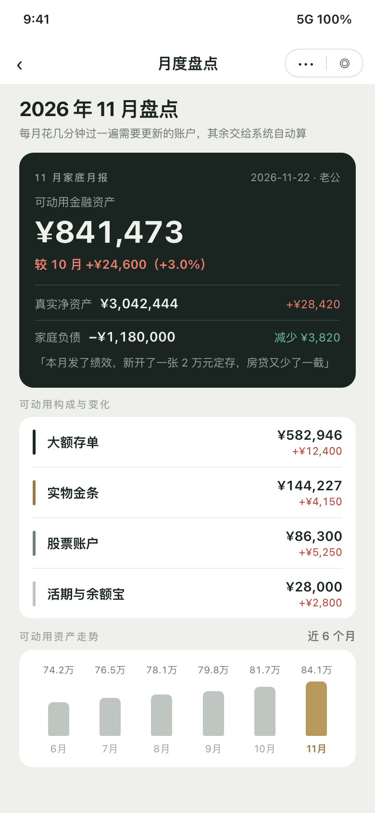
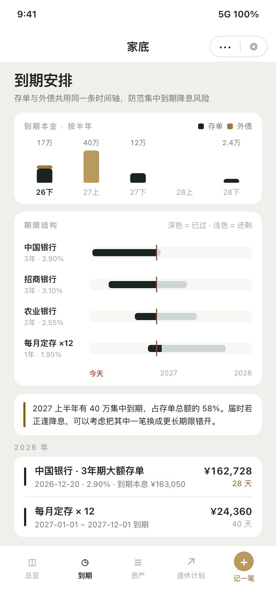

# 家底（Family Asset Miniprogram）

> **免服务器的家庭资产台账微信小程序** —— 回答两个最实在的问题：**我手上有多少钱能动？有什么快到期了？**

它不是日常流水记账 App，而是面向中国家庭真实资产结构设计的**低频录入、高频浏览**资产总览工具：基于原生微信小程序 + 微信云开发（CloudBase），**不需要买服务器、不需要域名备案、不存任何银行/券商密码**，拿一个个人微信小程序账号 10 分钟就能免费部署自用，还支持夫妻/家人共享同一本账本。

## 界面预览（示例数据）

<table>
  <tr>
    <td align="center"><br/><sub><b>首页总览</b> · 四层结构与真实净资产</sub></td>
    <td align="center"><br/><sub><b>目标配比</b> · 双条对比与不损息建议</sub></td>
    <td align="center"><br/><sub><b>月度盘点</b> · 家庭月报与走势</sub></td>
    <td align="center"><br/><sub><b>到期安排</b> · 半年柱图与存单梯子</sub></td>
  </tr>
</table>

---

## 核心特性

### 1. 六种类型覆盖全部家庭资产与负债（「录一次就一直准」）

| 类型 | 怎么算出「今天值多少」 | 适用场景 |
|---|---|---|
| `accrual` 计息型 | 本金 + 利率 + 起止日 → **每天自动算息**（支持每月定存梯子、到期自动转存） | 大额存单、定期存款、国债、借出去的钱 |
| `balance` 余额型 | 手填或**支付宝/微信截图 AI 识图更新**（支持每月自动定投存入） | 余额宝、支付宝总资产、零钱通、活期 |
| `quantity` 计量型 | 克数 × 单价（**每日自动抓上金所 Au99.99 金价**） | 实物金条、积存金 |
| `market` 市值型 | 录持仓（A 股 / ETF / 港股）**每个交易日 15:40 自动按收盘价算市值**，或券商截图 AI 识图 | 股票账户、场内 ETF、港股 |
| `appraisal` 估值型 | 手填估值，或按年折旧率自动递减 | 自住房、家用车 |
| `loan` 负债型 | 填剩余本金 + 利率 + 剩余期数（等额本息 / 等额本金 / 先息后本）→ **每月自动递减本金、算月供与剩余利息** | 房贷、车贷、公积金贷款、简单欠款 |

### 2. 四层结构，看清「可动用」与「真实净资产」
- **第一层 · 可动用金融资产**：存单、活期/余额宝、实物金条、股票 —— **首页主角大数字**
- **第二层 · 应收外债**：借出去的钱 —— 默认折叠，不进首页提醒添堵
- **第三层 · 固定资产**：房子、车子 —— 不稀释金融资产占比
- **第四层 · 负债（减项）**：房贷、车贷等 —— 自动从底部净资产扣除，还原真实净资产（$\text{净资产} = \text{可动用} + \text{外债} + \text{固定资产} - \text{负债}$）

### 3. 支付宝 & 券商 AI 多模态识图
- 支持对接任意 OpenAI 兼容视觉模型（**智谱免费 `glm-4v-flash` / 通义千问 `qwen-vl-plus` / 豆包视觉**等），并自动兼容腾讯云 OCR 兜底。
- **支付宝总资产截图**：自动识别总资产、余额宝、余额、基金、理财、黄金等分项，一键点选填入。
- **券商持仓截图**：自动识别总资产、总盈亏、可用资金，并支持**直接识别持仓个股代码与股数，批量拉取行情切到自动更新**。
- **隐私零留存**：截图识别完成后无论成功或失败，云函数 `finally` 立即从云存储删除原图，只保留数字。

### 4. 每月 10 分钟盘点 & 家底月报
- 自动分拣**「需要核对的项」**与**「系统自动追踪的项」**，在盘点页原地一键截图更新 / 改金额 / 标无变动。
- 结账立即存档并生成**家庭月报**：展示本月可动用与净资产较上月变化、负债减少额、各类资产分项增减，以及**近 6 个月资产走势柱状图**。

### 5. 目标配比 & 不损息再平衡建议
- 针对可动用金融资产 4 大类（存单 / 股票 / 黄金 / 活期），内置 **达利欧全天候 (55/30/10/5)**、**稳健家庭版 (60/20/10/10)**、**永久组合 (25/25/25/25)** 三套经典模板，支持随时自由拖动滑块调整。
- 可自定义偏离容忍区间（默认 `±5%`），平时均衡隐身，超标时首页温和提示。
- **贴合中国家庭的不损息建议**：不叫你提前支取存单，优先联动**超配活期、未来 90 天到期存单、每月新增存款**给出实操调仓建议，并附带股市大跌 30% 压力测试。

### 6. 到期梯子、退休计划、夫妻共享与隐私保护
- **到期页**：半年到期本金柱状图 + 存单期限甘特梯子图 + 集中到期降息风险提示。
- **退休计划**：Canvas 堆叠面积图区分「已锁定利息 / 未来存入 / 假设收益」，支持滑块实时推演达成日期与计划支出（换车/装修/学费）。
- **家庭共享**：通过 `api` 云函数按 `familyId` 隔离权限，支持 6 位邀请码 + 微信分享卡片邀请家人共用同一份账本。
- **双重隐私保护**：首页一键隐藏/模糊全部金额 + **面容 ID / 指纹生物解锁**（切后台超过 60 秒自动重新验证）。
- **深色模式**：完整适配 iOS / 微信深色模式。

---

## 10 分钟免费部署教程

### 第 1 步：注册个人小程序
在 [微信公众平台](https://mp.weixin.qq.com) 注册个人主体微信小程序账号，拿到 **AppID**（个人主体即可，无需企业资质）。

### 第 2 步：导入项目并开通云开发
1. 克隆本仓库，用 [微信开发者工具](https://developers.weixin.qq.com/miniprogram/dev/devtools/download.html) 打开项目目录。
2. 将 `project.config.json` 中的 `REPLACE_WITH_YOUR_APPID` 改为你自己的 AppID。
3. 点击顶部 **「云开发」** → 开通并新建环境（免费额度足够家庭长期使用）→ 复制 **环境 ID**。
4. 打开根目录 `config.js`（参考 `config.example.js`），将 `ENV_ID` 替换为你的环境 ID：

```js
module.exports = {
  ENV_ID: 'cloud1-xxxxxxxx',
  GOLD_KEY: 'gold_au9999',
  CURRENT_RATE: 0.20
};
```

### 第 3 步：创建 5 个云数据库集合
进入云开发控制台 → **数据库** → 依次新建集合并**务必按表设置最严权限**：

| 集合名 | 用途 | 推荐权限 |
|---|---|---|
| `asset` | 资产与负债记录 | **仅创建者可读写** |
| `market_data` | 金价等公开行情缓存 | 所有用户可读，仅管理端可写 |
| `snapshot` | 每日快照与月度盘点记录 | **仅创建者可读写** |
| `forecast_config` | 退休计划与目标配比配置 | **仅创建者可读写** |
| `family` | 家庭成员、邀请码与存单计划 | **仅创建者可读写** |

> 所有读写均走 `api` 云函数校验家庭成员身份，因此数据库集合权限可以直接设为最严，外人绝对无法访问。

### 第 4 步：上传 5 个云函数与定时触发器
在微信开发者工具左侧 `cloudfunctions` 目录下，对以下 5 个云函数逐个右键 → **上传并部署：云端安装依赖**：

- `api` —— 数据与家庭权限网关
- `goldPrice` —— 每日抓取上金所 Au99.99 金价
- `stockPrice` —— 每个交易日按收盘价刷新 A 股 / ETF / 港股持仓市值
- `dailySnapshot` —— 每日自动开单、自动转存、留存资产快照
- `ocrAccount` —— 支付宝 / 券商截图 AI 识图（识别完即删图）

然后对 `goldPrice`、`stockPrice`、`dailySnapshot` 分别右键 → **上传触发器**（东八区时间：股价 15:40、金价 16:00、快照 23:30）。

### 第 5 步：配置 AI 识图环境变量（可选，推荐）
进入云开发控制台 → 云函数 → `ocrAccount` → **版本与配置 → 配置 → 环境变量**，添加以下 3 项（兼容任意 OpenAI 格式多模态视觉模型，超时时间建议调至 `30` 秒）：

| 环境变量 | 智谱免费推荐（GLM-4V） | 通义千问（Qwen-VL） | 豆包视觉（火山方舟） |
|---|---|---|---|
| `AI_API_KEY` | 你的智谱 API Key | 你的百炼 API Key | 你的方舟 API Key |
| `AI_BASE_URL` | `https://open.bigmodel.cn/api/paas/v4` | `https://dashscope.aliyuncs.com/compatible-mode/v1` | `https://ark.cn-beijing.volces.com/api/v3` |
| `AI_MODEL` | `glm-4v-flash` | `qwen-vl-plus` | 你的视觉模型接入点 ID |

> 如习惯使用腾讯云通用 OCR，也可配置 `TENCENT_SECRET_ID` 与 `TENCENT_SECRET_KEY` 作为兜底引擎。

### 第 6 步：初始化金价并体验
右键 `goldPrice` → 云端测试运行一次，确认 `market_data` 写入当日金价后，即可预览或上传体验版使用！邀请爱人时，先在微信公众平台 **成员管理 → 体验成员** 添加微信号，再在小程序「家庭账本」页生成 6 位邀请码发给对方即可。

---

## 目录结构

```text
config.js / config.example.js   云开发环境配置
app.js / app.json / app.wxss    入口、页面注册与墨绿/纸白/黄铜设计令牌
utils/
  calc.js         六种资产与负债计价核心 ★ 单一真相来源
  forecast.js     按月迭代退休预测引擎
  allocation.js   4 大类目标配比与不损息再平衡建议
  checkin.js      每月 10 分钟盘点分拣与月报引擎 ★ 单一真相来源
  stock.js        股票代码规范化与新浪行情解析 ★ 单一真相来源
  ocrparse.js     AI 识图 JSON 清洗与 OCR 坐标解析 ★ 单一真相来源
  recurring.js    每月自动定存与到期转存逻辑 ★ 单一真相来源
  lock.js         苹果面容 ID / 指纹生物解锁封装
  money.js        金额整数「分」存储与格式化
  db.js / load.js 云函数网关调用与页面装载
pages/
  home/           首页总览（可动用 ⇄ 净资产、配比提示、临期提醒、四层折叠）
  due/            到期安排（半年柱状图、存单甘特梯子图、集中度提示）
  assets/         四层全部资产与负债明细
  forecast/       退休计划（Canvas 堆叠面积图 + 参数滑块 + 计划支出）
  edit/           记一笔 / 资产与负债详情 / 每月存单计划
  checkin/        每月 10 分钟盘点向导与家庭月报
  allocation/     目标配比对比、滑块调节与再平衡建议
  family/         家庭成员、邀请码共享与本机生物解锁设置
cloudfunctions/
  api/            数据与家庭权限网关
  goldPrice/      每日金价抓取
  stockPrice/     每日收盘股价刷新
  ocrAccount/     支付宝/券商截图多模态 AI 识图（阅后即焚）
  dailySnapshot/  每日快照、自动开单与自动转存
scripts/
  sync-utils.sh   将 utils/ 单一真相文件同步至各云函数 lib/
  checkbind.js    校验全部 WXML 事件绑定与页面完整性
  selftest.js     计价与五年预测回归验证
  test-ocr.js     AI 识图与支付宝/券商 OCR 解析测试
  test-checkin.js 月度盘点与月报引擎测试
  test-allocation.js 目标配比与再平衡建议测试
  test-loan.js    房贷/车贷摊还与净资产扣减测试
```

---

## 本地开发与自测

```bash
./scripts/sync-utils.sh          # 修改 utils/ 核心文件后同步到云函数 lib/
node scripts/checkbind.js        # 校验全部页面事件绑定与文件完整性
node scripts/selftest.js         # 计价与预测回归测试
node scripts/test-ocr.js         # 支付宝 & 券商 AI 识图 / OCR 解析测试
node scripts/test-checkin.js     # 每月 10 分钟盘点与月报测试
node scripts/test-allocation.js  # 目标配比与再平衡测试
node scripts/test-loan.js        # 房贷 / 车贷摊还与净资产扣减测试
```

---

## 设计原则与安全声明

- **金额一律以整数「分」存储**，避免 JavaScript 浮点精度误差。
- **绝不托管银行或券商账号密码**，股价与金价仅抓取公开行情，截图识别完立即物理删除。
- **软删除机制**：结清资产仅标记 `status: 'closed'`，历史快照不受破坏。
- 本项目仅供个人与家庭自用记账与资产盘点参考，不构成任何投资或理财建议。

## License

[MIT](./LICENSE)
